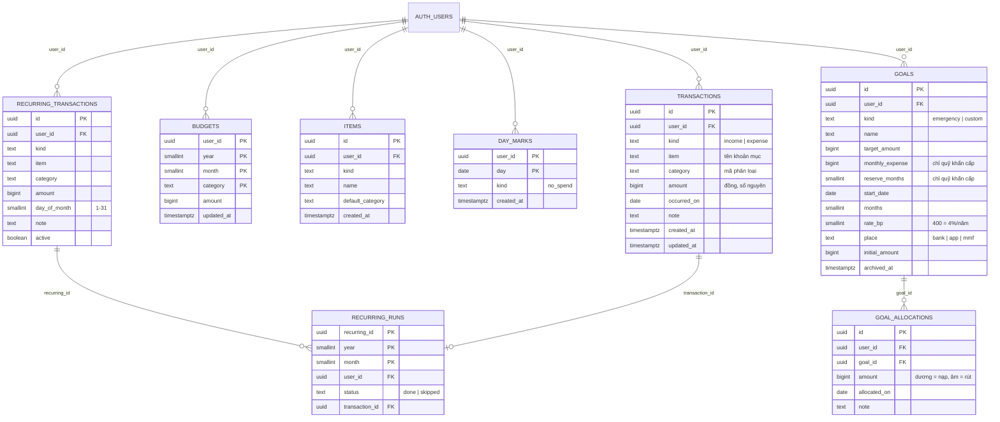

# Tài liệu Database — CT9 Finance

Tài liệu này giải thích dữ liệu của ứng dụng được lưu thế nào, tại sao thiết kế như vậy, và cách bạn tự xem, truy vấn, sửa dữ liệu. Đọc từ trên xuống nếu mới làm quen; các mục sau có thể đọc riêng.

> Nguồn sự thật là file [`supabase/schema.sql`](../supabase/schema.sql). Tài liệu này giải thích file đó bằng tiếng Việt, nếu hai bên khác nhau thì tin file SQL.

## Mục lục
1. [Bức tranh tổng thể](#1-bức-tranh-tổng-thể)
2. [Từ Excel sang database](#2-từ-excel-sang-database)
3. [Sơ đồ các bảng](#3-sơ-đồ-các-bảng)
4. [Bảng mã phân loại](#4-bảng-mã-phân-loại)
5. [Chi tiết từng bảng](#5-chi-tiết-từng-bảng)
6. [Hàm và trigger](#6-hàm-và-trigger)
7. [Bảo mật: mỗi người chỉ thấy dữ liệu của mình](#7-bảo-mật-mỗi-người-chỉ-thấy-dữ-liệu-của-mình)
8. [Dữ liệu đi qua ứng dụng thế nào](#8-dữ-liệu-đi-qua-ứng-dụng-thế-nào)
9. [Các câu truy vấn hữu ích](#9-các-câu-truy-vấn-hữu-ích)
10. [Thay đổi cấu trúc về sau](#10-thay-đổi-cấu-trúc-về-sau)
11. [Lưu ý và giới hạn](#11-lưu-ý-và-giới-hạn)
12. [Gặp lỗi thường gặp](#12-gặp-lỗi-thường-gặp)

---

## 1. Bức tranh tổng thể

**Supabase** cho bạn một database **PostgreSQL** (loại database quan hệ, dùng ngôn ngữ SQL) cùng hệ thống đăng nhập. Dữ liệu nằm trong các **bảng** (giống sheet Excel), mỗi bảng có các **cột** (tiêu đề) và các **dòng** (bản ghi).

```
 Trình duyệt / điện thoại
        │  (bạn bấm, nhập)
        ▼
 Next.js trên Vercel ── kiểm tra bạn đã đăng nhập chưa
        │  (kèm "thẻ đăng nhập" JWT của bạn)
        ▼
 Supabase
   ├─ Auth      : quản lý tài khoản, mật khẩu, phiên đăng nhập
   └─ Postgres  : 3 bảng + 1 view + 2 hàm + quy tắc bảo mật (RLS)
```

Bốn bảng của ứng dụng:

| Bảng | Lưu gì | Giống phần nào của Excel |
|---|---|---|
| `transactions` | Mọi khoản **thu** và **chi** thực tế | Sheet *Thu Chi* |
| `budgets` | Số tiền **dự kiến** từng tháng | Các ô vàng sheet *Lập ngân sách* |
| `items` | Danh mục **khoản mục** để gợi ý khi nhập | Danh sách khoản mục ở sheet *Phân loại thu chi* |
| `day_marks` | Những ngày bạn đánh dấu **"Không chi tiêu"** | (mới, không có trong Excel) |

Ngoài ra có bảng `auth.users` do Supabase tự quản (chứa email, mật khẩu đã mã hoá). Bạn không tự sửa bảng này bằng SQL, mà dùng **Authentication → Users** trên dashboard.

## 2. Từ Excel sang database

### Dữ liệu nhập vào
Trong Excel, thu nhập (cột A–E) và chi tiêu (cột G–K) là **hai bảng đặt cạnh nhau**. Trong database gộp thành **một bảng** `transactions` có thêm cột `kind` để phân biệt thu (`income`) hay chi (`expense`). Cách này giúp thêm, tìm, sắp xếp theo ngày dễ hơn, và không giới hạn số dòng.

| Excel | Cột database |
|---|---|
| Tên khoản mục | `item` |
| Ngày nhận / Ngày chi | `occurred_on` |
| Phân loại | `category` |
| Số tiền | `amount` |
| Ghi chú | `note` |
| (bảng thu hay bảng chi) | `kind` |

Danh sách thả xuống ở Excel (Data Validation: "Thiết yếu, Không thiết yếu...") tương ứng với các **ràng buộc `check`** trong database, chặn giá trị sai ngay từ gốc.

### Dữ liệu tính ra: không lưu
Mọi ô có công thức trong sheet *Phân loại thu chi* và *Lập ngân sách* (tổng, tỷ trọng, thặng dư, chênh lệch, trung bình...) **không được lưu trong database**. Ứng dụng tính lại mỗi khi mở trang, trong file [`lib/finance.ts`](../lib/finance.ts).

Lý do: nếu lưu "tổng tháng 10" thành một số, bạn sửa một giao dịch thì phải nhớ cập nhật số đó, dễ lệch. Chỉ lưu dữ liệu gốc thì con số luôn đúng.

Công thức `SUMPRODUCT(Số tiền × (Phân loại = X) × (Tháng = n))` trong Excel chính là câu SQL "cộng `amount` của các dòng có `category = X` và tháng = n" (xem [mục 9](#9-các-câu-truy-vấn-hữu-ích)).

Điểm khác Excel: `MONTH()` trong Excel chỉ lấy số tháng, nên dữ liệu tháng 10/2025 và 10/2026 bị cộng chung. Database lưu cả năm nên tính riêng từng năm.

## 3. Sơ đồ các bảng

> Sơ đồ dưới đây dùng Mermaid. Nếu VS Code chỉ hiện ra đoạn mã, cài extension **Markdown Preview Mermaid Support**, hoặc xem file này trên GitHub (tự vẽ sơ đồ).



Hai điểm cần hiểu:

- **`transactions.item` là chữ, không phải khoá liên kết tới `items`.** Đây là thiết kế có chủ ý: bạn xoá một khoản mục khỏi danh mục thì các giao dịch cũ **vẫn nguyên**. Bảng `items` chỉ là danh sách gợi ý.
- **Mọi bảng có `user_id`** trỏ tới tài khoản sở hữu. Khi xoá tài khoản trong Supabase, toàn bộ dữ liệu của tài khoản đó bị xoá theo (`on delete cascade`).

## 4. Bảng mã phân loại

Database lưu mã tiếng Anh (ngắn, ổn định), giao diện hiển thị tiếng Việt (khai báo ở [`lib/categories.ts`](../lib/categories.ts)).

| Mã (`category`) | Hiển thị | `kind` | Tính vào "Tổng chi tiêu"? |
|---|---|---|---|
| `main` | Thu nhập chính | income | — |
| `side` | Thu nhập phụ | income | — |
| `irregular` | Thu nhập bất thường | income | — |
| `essential` | Thiết yếu | expense | Có |
| `non_essential` | Không thiết yếu | expense | Có |
| `incidental` | Phát sinh | expense | Có |
| `saving` | Tiết kiệm/Đầu tư | expense | **Không** (tính riêng, giống Excel) |

Database từ chối ghi kiểu `kind = 'income'` mà `category = 'essential'` (ràng buộc `transactions_category_matches_kind`).

## 5. Chi tiết từng bảng

### 5.1 `transactions` — giao dịch

| Cột | Kiểu | Ý nghĩa |
|---|---|---|
| `id` | uuid | Mã định danh, tự sinh |
| `user_id` | uuid | Chủ giao dịch, tự điền bằng người đang đăng nhập (`default auth.uid()`) |
| `kind` | text | `income` hoặc `expense` |
| `item` | text | Tên khoản mục, 1–100 ký tự (sau khi cắt khoảng trắng) |
| `category` | text | Mã phân loại, phải khớp `kind` (xem mục 4) |
| `amount` | bigint | Số tiền **đồng, số nguyên**, lớn hơn 0 và nhỏ hơn 1.000 tỷ |
| `occurred_on` | date | Ngày thu/chi (chỉ ngày, không có giờ) |
| `note` | text | Ghi chú, tối đa 500 ký tự, được để trống |
| `created_at` | timestamptz | Lúc tạo (dùng để sắp xếp giao dịch cùng ngày) |
| `updated_at` | timestamptz | Lúc sửa gần nhất, trigger tự cập nhật |

- Số tiền luôn **dương**. Thu hay chi do `kind` quyết định, không dùng số âm.
- Chỉ mục `transactions_user_date_idx (user_id, occurred_on desc, created_at desc)` giúp tải danh sách theo ngày nhanh khi dữ liệu nhiều.

### 5.2 `budgets` — ngân sách dự kiến

Khoá chính gồm 4 cột `(user_id, year, month, category)`. Nghĩa là mỗi tổ hợp *người dùng + năm + tháng + phân loại* chỉ có **một** dòng, tương ứng một ô vàng trong Excel.

| Cột | Ý nghĩa |
|---|---|
| `year`, `month` | Năm (2000–2100), tháng (1–12) |
| `category` | Một trong 7 mã ở mục 4. Thu nhập dự kiến, chi tiêu dự kiến và tiết kiệm dự kiến đều nằm chung bảng này |
| `amount` | Số tiền dự kiến, ≥ 0, mặc định 0 |
| `updated_at` | Trigger tự cập nhật |

- Chỉ lưu **dự kiến**. Số **thực tế** lấy từ `transactions`, nên không bao giờ lệch.
- Không có dòng nghĩa là "chưa đặt ngân sách" (ứng dụng hiểu là 0 và hiển thị "Chưa đặt ngân sách").
- Khi bạn bấm "Lưu ngân sách", ứng dụng dùng **upsert**: có dòng rồi thì cập nhật, chưa có thì thêm. Ô "áp dụng cho các tháng sau" chỉ là ghi cùng số cho các tháng 11, 12...

### 5.3 `items` — danh mục khoản mục

| Cột | Ý nghĩa |
|---|---|
| `kind` | `income` hoặc `expense` (khoản mục thu và chi tách riêng) |
| `name` | Tên khoản mục, ví dụ "Ăn uống" |
| `default_category` | Phân loại mặc định điền sẵn khi chọn khoản mục. `null` = tự động lấy phân loại bạn dùng lần gần nhất |

Ràng buộc `unique (user_id, kind, name)`: không có hai khoản mục trùng tên trong cùng một loại.

### 5.4 `item_usage` — view thống kê (không phải bảng)

**View** là một câu truy vấn được đặt tên, dùng như bảng nhưng không tự lưu dữ liệu. `item_usage` gom `transactions` theo khoản mục và cho biết:

| Cột | Ý nghĩa |
|---|---|
| `uses` | Số lần đã dùng |
| `last_used_on` | Ngày dùng gần nhất |
| `last_category` | Phân loại ở lần dùng gần nhất |

Form nhập giao dịch dùng nó để xếp khoản mục hay dùng lên đầu và tự điền phân loại. View được tạo với `security_invoker`, nghĩa là chạy bằng quyền của người gọi nên vẫn tuân theo quy tắc bảo mật ở mục 7.

### 5.5 `day_marks` — ngày "Không chi tiêu"

Ứng dụng tính **chuỗi ngày ghi chép** (thẻ "Hôm nay" ở trang chủ). Một ngày được coi là *đã ghi* khi có ít nhất một giao dịch, **hoặc** bạn đánh dấu ngày đó là "Không chi tiêu". Nếu không có bảng này, một ngày tiết kiệm trông giống ngày bỏ quên, và bạn sẽ bị cám dỗ ghi một khoản 0đ giả (database cũng không cho phép, vì `amount > 0`).

| Cột | Ý nghĩa |
|---|---|
| `user_id` | Chủ sở hữu, tự điền (`default auth.uid()`) |
| `day` | Ngày được đánh dấu (kiểu `date`) |
| `kind` | Hiện chỉ có `no_spend` |
| `created_at` | Lúc đánh dấu |

- Khoá chính `(user_id, day)`: mỗi ngày tối đa **một** dòng.
- Quy tắc ứng dụng (kiểm tra ở Server Action `markNoSpend`): chỉ đánh dấu được ngày **không ở tương lai**, trong vòng **62 ngày** gần đây, và ngày đó **chưa có khoản chi**. Khi bạn lưu một khoản chi vào ngày đã đánh dấu, dấu đó tự bị xoá.
- Giao dịch luôn thắng dấu: nếu một ngày vừa có dấu vừa có khoản chi (ví dụ do ghi bù), ứng dụng hiển thị là *đã ghi*, không phải "không chi tiêu".
- Bảng có cùng RLS như các bảng khác: chỉ chủ sở hữu đọc/ghi được.

**Nếu bạn nâng cấp từ bản cũ:** chạy lại toàn bộ `supabase/schema.sql` trong SQL Editor (không mất dữ liệu). Chưa chạy thì ứng dụng vẫn dùng bình thường, chỉ ẩn các nút "Không chi tiêu".

### 5.6 `recurring_transactions` — mẫu giao dịch định kỳ

Mỗi dòng là một khoản lặp lại hằng tháng: tiền nhà, điện nước, wifi, lương…

| Cột | Ý nghĩa |
|---|---|
| `kind`, `item`, `category`, `amount`, `note` | Giống `transactions` (cùng ràng buộc: số tiền > 0, phân loại khớp loại) |
| `day_of_month` | Ngày trong tháng, 1–31. Tháng ngắn hơn thì rơi vào **ngày cuối tháng** (31 → 30/4, 28 hoặc 29/2) |
| `active` | `false` = tạm dừng, không gợi ý nữa nhưng không xoá |

Mẫu **không tự tạo giao dịch**. Đến ngày, trang Tổng quan gợi ý và bạn bấm Xác nhận (sửa được số tiền) hoặc Bỏ qua. Xoá một mẫu không xoá các giao dịch nó đã tạo trước đó.

### 5.7 `recurring_runs` — đã xác nhận / bỏ qua tháng nào

Khoá chính `(recurring_id, year, month)`: mỗi mẫu mỗi tháng tối đa **một** dòng, nên không bao giờ bị ghi trùng.

| Cột | Ý nghĩa |
|---|---|
| `status` | `done` = đã xác nhận, `skipped` = bỏ qua tháng này |
| `transaction_id` | Giao dịch đã tạo khi xác nhận (bắt buộc khi `done`, trống khi `skipped`) |

- `transaction_id ... on delete cascade`: xoá giao dịch đó (kể cả bấm "Hoàn tác") thì dòng này tự xoá theo, khoản định kỳ lại hiện ra chờ xác nhận.
- Ngày ghi khi xác nhận: **ngày đến hạn** nếu đã qua (tiền nhà ngày 1 xác nhận ngày 3 vẫn ghi ngày 1), hoặc **hôm nay** nếu xác nhận sớm.
- Quy tắc RLS chỉ cho ghi dòng có mẫu định kỳ cũng thuộc chính bạn.

### 5.8 `goals` — quỹ mục tiêu

Tương ứng file Excel *Theo dõi mục tiêu tài chính*: mỗi quỹ một dòng, không giới hạn số lượng.

| Cột | Ý nghĩa |
|---|---|
| `kind` | `emergency` = Quỹ khẩn cấp (mỗi tài khoản tối đa **một**), `custom` = quỹ tự tạo |
| `target_amount` | Số tiền mục tiêu. Với quỹ khẩn cấp luôn bằng `monthly_expense × reserve_months` (database kiểm tra) |
| `monthly_expense`, `reserve_months` | Chỉ quỹ khẩn cấp: chi phí cố định 1 tháng và số tháng dự phòng (1–24) |
| `start_date`, `months` | Ngày bắt đầu và số tháng thực hiện. Hạn = ngày bắt đầu + số tháng |
| `rate_bp` | Lợi nhuận kỳ vọng tính bằng phần vạn: 400 = 4%/năm. Tối đa 1200 (12%/năm), giống giới hạn "không thực tế" của file Excel |
| `place` | Nơi cất quỹ: `bank` (nhận đủ gốc + lãi), `app` (gốc + 95% lãi), `mmf` (99,9% tổng giá trị) |
| `initial_amount` | Tiền đã có sẵn cho quỹ từ trước, không lấy từ tiền tiết kiệm trong app |
| `archived_at` | Đã lưu trữ (quỹ đã dùng xong). Tiền của quỹ vẫn tính là đã dùng |

**Các con số tính ra (không lưu)**, ở [`lib/goals.ts`](../lib/goals.ts), đã đối chiếu với sheet "Ví dụ" của file Excel:
- *Cần tiết kiệm mỗi tháng (kế hoạch)* = `ROUNDUP(PMT(lãi/12, số tháng, −đã có, mục tiêu, 1), −3)`.
- *Số dư* = các lần nạp/rút cộng lãi đơn theo **số ngày thực tế** giữa các lần (số dư × lãi ÷ 365 × số ngày), tính tới hôm nay.
- *Cần gửi mỗi tháng từ giờ* = tính lại từ số dư hiện tại và số tháng còn lại (cột "Cần tiết kiệm các tháng sau").
- *Khả thi*: tổng cần gửi mỗi tháng của các quỹ so với ngân sách *Tiết kiệm/Đầu tư* của tháng: lớn hơn = chưa khả thi, từ 75% = khả thi, dưới 75% = rất khả thi.

### 5.9 `goal_allocations` và view `savings_pool` — chia tiền tiết kiệm vào quỹ

- **Tiền tiết kiệm** = tổng mọi giao dịch nhóm *Tiết kiệm/Đầu tư*. View `savings_pool` trả về `saved` (tổng đó) và `allocated` (tổng đã chia vào quỹ) của người đang đăng nhập; *chưa phân bổ* = `saved − allocated`.
- Mỗi dòng `goal_allocations` là một lần nạp (số dương) hoặc rút (số âm). Rút ra thì tiền quay về phần chưa phân bổ.
- **Chi từ quỹ** (`spend_from_goal`): tạo một giao dịch chi có `from_savings = true` và một dòng `goal_allocations` số âm có `transaction_id` trỏ tới giao dịch đó, trong một lần. View `savings_pool` có thêm cột `spent` (tổng các khoản chi từ quỹ); *chưa phân bổ* = `saved − spent − allocated`, nên chi từ quỹ không làm đổi phần chưa phân bổ, còn rút thì làm tăng.
- Xoá giao dịch chi từ quỹ (kể cả "Hoàn tác") thì dòng `goal_allocations` của nó bị xoá theo (`on delete cascade`), tiền về lại quỹ. Sửa số tiền hoặc ngày ở Thu chi thì trigger `sync_goal_spend` cập nhật theo; đổi sang khoản thu hoặc nhóm Tiết kiệm thì giao dịch thôi là chi từ quỹ.
- Ứng dụng mặc định **không tính** khoản chi từ quỹ vào thặng dư tháng (tiền đã để dành từ trước); người dùng tick "Tính cả chi từ quỹ" để tính. "Tích lũy" luôn = thu nhập − chi tiêu thật.
- Xoá một quỹ (kể cả Quỹ khẩn cấp, sau đó có thể thiết lập lại) thì các dòng của nó bị xoá theo (`on delete cascade`), tiền quay về phần chưa phân bổ. Giao dịch tiết kiệm đã ghi không bị ảnh hưởng.

## 6. Hàm và trigger

**`set_updated_at()` + 2 trigger** — Trước mỗi lần sửa một dòng ở `transactions` hoặc `budgets`, trigger tự gán `updated_at = now()`. Bạn không cần tự cập nhật cột này.

**`rename_item(kind, tên cũ, tên mới, đổi cả giao dịch?)`** — Đổi tên khoản mục. Làm trong một lần (một câu lệnh gọi, nên thành công cả hoặc thất bại cả):
1. Nếu tên mới **chưa** có trong danh mục: đổi tên ngay trong `items`.
2. Nếu tên mới **đã có**: xoá khoản mục cũ khỏi `items` (gộp hai khoản mục làm một).
3. Nếu bạn tick "đổi tên cả các giao dịch đã ghi": cập nhật cột `item` của các giao dịch cũ sang tên mới.

Hàm chạy với quyền người gọi (`security invoker`), chỉ người đã đăng nhập mới gọi được và chỉ tác động lên dữ liệu của chính họ.

**`confirm_recurring(mẫu, năm, tháng, số tiền, ngày)`** — Xác nhận khoản định kỳ của một tháng: tạo giao dịch và ghi `recurring_runs` trong **một** lần (thành công cả hoặc thất bại cả). Bấm hai lần hoặc xác nhận từ hai thiết bị thì lần sau bị từ chối, không tạo giao dịch trùng. Tháng đã "bỏ qua" vẫn xác nhận lại được. Cũng chạy với quyền người gọi.

**`allocate_savings(danh sách quỹ + số tiền, ngày, ghi chú)`** — Chia tiền tiết kiệm vào một hoặc nhiều quỹ (hoặc rút ra) trong **một** lần. Từ chối nếu tổng chia vượt số chưa phân bổ (`saved − spent − allocated`), nếu rút quá số đã chia vào quỹ đó, hoặc nếu quỹ đã lưu trữ. Khoá theo tài khoản nên hai lần bấm cùng lúc không thể chia vượt số tiền có. Chạy với quyền người gọi.

## 7. Bảo mật: mỗi người chỉ thấy dữ liệu của mình

Điểm mấu chốt cần hiểu: **key `sb_publishable_...` nằm trong code chạy ở trình duyệt, ai cũng xem được**. Vì vậy an toàn không đến từ việc giấu key, mà từ **Row Level Security (RLS)** — quy tắc nằm ngay trong database, quyết định mỗi người được đọc/ghi những dòng nào.

Schema thiết lập 3 lớp:

1. **Bật RLS** cho cả 4 bảng. Khi RLS bật mà chưa có quy tắc cho phép thì không ai đọc được gì.
2. **Một quy tắc (policy) "Owner full access"** cho mỗi bảng: người đã đăng nhập chỉ đọc/thêm/sửa/xoá được dòng mà `user_id` trùng với id của chính mình.
   ```sql
   using      ((select auth.uid()) = user_id)   -- dòng nào được nhìn/sửa/xoá
   with check ((select auth.uid()) = user_id)   -- dòng nào được phép ghi vào
   ```
   `auth.uid()` là id của người đang gọi, lấy từ thẻ đăng nhập. Bọc trong `(select ...)` để Postgres chỉ tính một lần cho cả truy vấn, nhanh hơn.
3. **Thu hồi quyền của khách chưa đăng nhập (`anon`)** trên mọi bảng, view và hàm. Họ nhận lỗi "permission denied".

Đã kiểm thử: một tài khoản thứ hai không đọc, sửa, xoá hay thêm dữ liệu giả mạo vào dữ liệu của tài khoản đầu; khách chưa đăng nhập bị từ chối; database từ chối số tiền âm và phân loại sai loại.

Ngoài database, mỗi Server Action trong ứng dụng cũng **tự kiểm tra lại đăng nhập** và kiểm tra dữ liệu (số tiền, ngày, phân loại) trước khi ghi. Đó là lớp phòng thủ thứ hai, không dựa vào việc giao diện đã kiểm tra.

> **Không bao giờ** đưa key `service_role` hay `sb_secret_...` vào code của ứng dụng hoặc biến `NEXT_PUBLIC_*`. Key đó **bỏ qua toàn bộ RLS**.

## 8. Dữ liệu đi qua ứng dụng thế nào

**Đọc** — [`lib/data.ts`](../lib/data.ts):
- Mỗi trang tải **cả năm** đang xem (giao dịch + ngân sách), rồi các phép tính và biểu đồ chạy trong trình duyệt. Nhờ vậy đổi tháng trên trang không phải tải lại.
- Supabase mặc định chỉ trả tối đa **1000 dòng/lần**, nên `getTransactionsForYear` tải từng trang 1000 dòng cho đến hết. Dữ liệu nhiều năm vẫn không bị cắt.
- Đổi năm thì mới tải dữ liệu năm đó.
- Riêng thẻ "Hôm nay" dùng `getHabitData`: đọc một **cửa sổ 63 ngày gần đây** (cộng ngân sách tháng này và các ngày `day_marks`), không phụ thuộc năm đang xem, để chuỗi ngày không bị ngắt khi sang năm mới. Chuỗi dài hơn 63 ngày hiển thị là "63+".

**Ghi** — [`lib/actions/`](../lib/actions):

| File | Thao tác |
|---|---|
| `transactions.ts` | `saveTransaction` (thêm hoặc sửa; trả về `id` để "Hoàn tác"), `deleteTransaction` |
| `budgets.ts` | `saveBudgetMonth` (upsert, có tuỳ chọn áp dụng các tháng sau) |
| `items.ts` | `createItem`, `updateItem` (gọi `rename_item` khi đổi tên), `deleteItem` |
| `day-marks.ts` | `markNoSpend`, `unmarkNoSpend` |
| `auth.ts` | `signIn`, `signOut`, `changePassword` |

Sau khi ghi, ứng dụng gọi `refresh()` để trang tự tải lại dữ liệu mới.

**Múi giờ**: cột `occurred_on` là `date` (không có giờ nên không bị lệch múi giờ). "Hôm nay" và "tháng hiện tại" luôn tính theo giờ Việt Nam (`Asia/Ho_Chi_Minh`) dù server Vercel chạy giờ UTC ([`lib/dates.ts`](../lib/dates.ts)).

**Kiểu dữ liệu TypeScript**: [`lib/supabase/database.types.ts`](../lib/supabase/database.types.ts) viết tay cho khớp schema, để code được kiểm tra kiểu khi truy vấn. Đổi schema thì phải sửa file này theo.

## 9. Các câu truy vấn hữu ích

Vào Supabase → **SQL Editor**, dán và chạy. Trong SQL Editor bạn chạy bằng quyền quản trị nên **thấy toàn bộ dữ liệu**, không bị RLS lọc (với một người dùng thì không ảnh hưởng gì).

> Chỉ chạy các câu `select` khi chưa quen. Câu `update`/`delete` có thể làm mất dữ liệu — xem lưu ý ở mục 11 trước khi dùng.

**Thu – chi – tiết kiệm theo tháng của năm 2026** (giống bảng ở sheet *Phân loại thu chi*):
```sql
select
  extract(month from occurred_on)::int                              as thang,
  sum(amount) filter (where kind = 'income')                        as thu_nhap,
  sum(amount) filter (where kind = 'expense' and category <> 'saving') as chi_tieu,
  sum(amount) filter (where category = 'saving')                    as tiet_kiem
from public.transactions
where occurred_on >= '2026-01-01' and occurred_on < '2027-01-01'
group by 1
order by 1;
```

**Chi tiêu tháng 10/2026 theo nhóm**:
```sql
select category, sum(amount) as tong, count(*) as so_giao_dich
from public.transactions
where kind = 'expense' and category <> 'saving'
  and occurred_on >= '2026-10-01' and occurred_on < '2026-11-01'
group by category
order by tong desc;
```

**Top khoản mục chi cả năm** (giống "Top khoản chi chi tiết"):
```sql
select item, sum(amount) as tong, count(*) as so_lan
from public.transactions
where kind = 'expense' and category <> 'saving'
  and occurred_on >= '2026-01-01' and occurred_on < '2027-01-01'
group by item
order by tong desc;
```

**Ngân sách dự kiến so với thực tế, tháng 10/2026**:
```sql
select b.category,
       b.amount                          as du_kien,
       coalesce(sum(t.amount), 0)        as thuc_te,
       coalesce(sum(t.amount), 0) - b.amount as chenh_lech
from public.budgets b
left join public.transactions t
       on t.user_id = b.user_id
      and t.category = b.category
      and extract(year  from t.occurred_on) = b.year
      and extract(month from t.occurred_on) = b.month
where b.year = 2026 and b.month = 10
group by b.category, b.amount
order by b.category;
```

**20 giao dịch mới nhất**:
```sql
select occurred_on, kind, item, category, amount, note
from public.transactions
order by occurred_on desc, created_at desc
limit 20;
```

**Khoản mục nào được dùng nhiều nhất** (chính là view `item_usage`):
```sql
select * from public.item_usage order by uses desc;
```

**Thặng dư từng tháng** (= thu − chi − tiết kiệm):
```sql
select
  extract(month from occurred_on)::int as thang,
  coalesce(sum(amount) filter (where kind = 'income'), 0)
  - coalesce(sum(amount) filter (where kind = 'expense'), 0) as thang_du
from public.transactions
where occurred_on >= '2026-01-01' and occurred_on < '2027-01-01'
group by 1
order by 1;
```
(Ở đây "chi" gồm cả tiết kiệm vì đã lấy hết `kind = 'expense'`, nên phép trừ này chính là thu − chi − tiết kiệm.)

**Những ngày đã đánh dấu "Không chi tiêu"**:
```sql
select day, created_at from public.day_marks order by day desc;
```

**Những ngày trong tháng 10/2026 chưa có ghi chép** (không có giao dịch và không có dấu):
```sql
select d::date as ngay
from generate_series('2026-10-01'::date, '2026-10-31'::date, interval '1 day') as d
where not exists (select 1 from public.transactions t where t.occurred_on = d::date)
  and not exists (select 1 from public.day_marks m where m.day = d::date)
order by ngay;
```

## 10. Thay đổi cấu trúc về sau

`supabase/schema.sql` được viết để **chạy lại nhiều lần không mất dữ liệu** (`create table if not exists`, `create or replace`, `drop policy if exists`...). Tuy nhiên **`create table if not exists` không sửa bảng đã có**. Nếu muốn thêm cột mới, ví dụ cột `tags` cho giao dịch, làm như sau:

1. Chạy trong SQL Editor:
   ```sql
   alter table public.transactions add column tags text[];
   ```
2. Thêm cột đó vào `create table` trong `schema.sql` để lần cài đặt sau (project mới) có đủ cột.
3. Sửa [`lib/supabase/database.types.ts`](../lib/supabase/database.types.ts) cho khớp.
4. Sửa phần code dùng cột mới (`lib/data.ts` chọn cột, `lib/validation.ts` kiểm tra, form nhập...).

Thêm một phân loại mới (ví dụ chi tiêu "Từ thiện") phải sửa cả: các ràng buộc `check` trong `schema.sql`, danh sách ở [`lib/finance.ts`](../lib/finance.ts), nhãn/màu ở [`lib/categories.ts`](../lib/categories.ts), và các bảng ngân sách. Đây là thay đổi lớn, nên nhờ hỗ trợ khi làm.

## 11. Lưu ý và giới hạn

- **Sao lưu**: hãy tự xuất dữ liệu định kỳ. Cách đơn giản nhất là trang **Thu chi → Xuất CSV** (mở được bằng Excel), hoặc **Table Editor** của Supabase → bảng → Export. Kiểm tra mục **Database → Backups** trên dashboard để biết gói của bạn có tự sao lưu hay không; đừng giả định là có.
- **Trước khi chạy `update`/`delete` bằng SQL**, hãy chạy `select` cùng điều kiện `where` trước để xem đúng các dòng định sửa. Thiếu `where` là sửa/xoá **toàn bộ** bảng.
- **Xoá tài khoản trong Authentication → Users sẽ xoá hết dữ liệu của tài khoản đó** (cascade).
- **Số tiền là số nguyên đồng.** Không hỗ trợ số lẻ hay ngoại tệ.
- **Hiện thiết kế cho một người dùng.** Nếu tạo thêm tài khoản thì mỗi tài khoản có dữ liệu riêng, tách biệt hoàn toàn. Lưu ý file `supabase/seed.local.sql` chỉ chạy khi có **đúng một** tài khoản.
- **Gói miễn phí của Supabase tạm dừng project sau khoảng 7 ngày không có truy cập.** Khi đó app báo "Không tải được dữ liệu"; vào dashboard bấm *Restore* (dữ liệu vẫn còn).

## 12. Gặp lỗi thường gặp

| Dấu hiệu | Nguyên nhân thường gặp | Cách xử lý |
|---|---|---|
| Đăng nhập xong báo "Không tải được dữ liệu" | Chưa chạy `schema.sql` (bảng chưa tồn tại) | Chạy `schema.sql` trong SQL Editor, kiểm tra **Table Editor** thấy đủ 4 bảng |
| Đăng nhập được nhưng mọi trang trống | Chưa nhập dữ liệu, hoặc dữ liệu thuộc **tài khoản khác** | Chạy `seed.local.sql`; kiểm tra chỉ có 1 tài khoản trong Authentication → Users |
| Chạy `seed.local.sql` báo "Cần đúng 1 tài khoản" | Chưa tạo tài khoản, hoặc có từ 2 tài khoản trở lên | Tạo/xoá cho còn đúng 1 tài khoản |
| Lưu giao dịch lỗi `permission denied` hoặc `row-level security` | Chưa đăng nhập, hoặc `user_id` không phải của bạn | Đăng nhập lại; không tự ghi `user_id` khác |
| Lỗi `violates check constraint` | Số tiền ≤ 0, phân loại không khớp loại thu/chi, ngày hoặc ghi chú vượt giới hạn | Sửa dữ liệu theo mục 5 |
| Lỗi `duplicate key` khi thêm khoản mục | Khoản mục cùng tên đã có | Dùng tên khác, hoặc sửa khoản mục cũ |
| Không thấy nút "Không chi tiêu" | Chưa chạy lại `schema.sql` nên bảng `day_marks` chưa có | Chạy lại toàn bộ `schema.sql` |
| Sau khi đổi schema, app lỗi kiểu dữ liệu | `database.types.ts` chưa cập nhật | Sửa file theo mục 10 |
